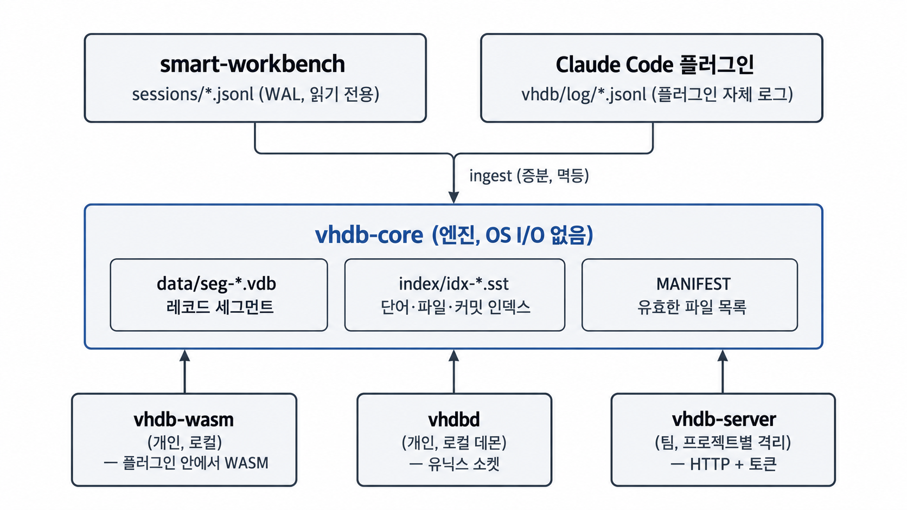

# VHDB — 바이브코딩 이력 데이터베이스

한국어 | [English](README.en.md)

바이브코딩 세션에서 오간 **대화, 판단, 오류, 해결, 편집, 커밋**을 저장하고, 나중에 "이거 전에 해 봤나?", "왜 이렇게 정했지?", "이 파일은 어떤 대화를 거쳐 지금 모양이 됐지?"에 답하는 전용 DB입니다. 처음부터 끝까지 Rust로 직접 만들었고 외부 DB에 기대지 않습니다.

- **세션 로그가 곧 WAL입니다.** [smart-workbench](https://github.com/nathak/smart-workbench)의 결정 원장(`/swb ledger on`)이 쓰는 `sessions/*.jsonl`을 그대로 읽습니다. smart-workbench는 수정하지 않고 읽기만 합니다. 파생 파일(세그먼트, 인덱스, 매니페스트)은 지워도 로그만으로 똑같이 다시 만들어집니다.
- **불변 파일 + 원자적 교체.** 체크섬이 붙은 세그먼트를 먼저 쓰고, `MANIFEST`를 원자적으로 바꿔야 새 상태가 됩니다. 어느 시점에 죽어도 같은 로그 바이트를 다시 읽어 같은 결과에 도달합니다.
- **검색은 인덱스, 정답은 전수 조사.** 인덱스로 찾은 결과가 모든 후보를 하나씩 점수 낸 결과와 같은지(점수 비트까지) 무작위 데이터로 계속 검사합니다.
- **같은 엔진이 세 곳에서 돕니다.** 로컬(WASM, Claude Code 플러그인 안), 개인용 데몬(`vhdbd`), 팀 서버(`vhdb-server`)가 같은 엔진 크레이트를 씁니다.

이 문서는 VHDB의 안내서입니다. 소스는 공개하지 않고, 설치 파일은 [릴리스 페이지](https://github.com/nathak/vhdb-public/releases/latest)에서 받습니다. Claude Code 플러그인은 [`nathak/vhdb-plugin`](https://github.com/nathak/vhdb-plugin)에 있습니다.

---

## 목차

1. [전체 그림](#1-전체-그림)
2. [빠른 시작](#2-빠른-시작)
3. [데이터 모델과 디렉터리](#3-데이터-모델과-디렉터리)
4. [질의 언어(VQL)와 순위](#4-질의-언어vql와-순위)
5. [명령줄 `vhdb`](#5-명령줄-vhdb)
6. [로컬 데몬 `vhdbd`](#6-로컬-데몬-vhdbd)
7. [WASM 엔진과 이력 로직](#7-wasm-엔진과-이력-로직)
8. [팀 서버 `vhdb-server`](#8-팀-서버-vhdb-server)
9. [대규모 데이터: 파티션, 압축, 계층, 벡터](#9-대규모-데이터-파티션-압축-계층-벡터)
10. [보장하는 것](#10-보장하는-것)
11. [성능](#11-성능)
12. [한계와 로드맵](#12-한계와-로드맵)

---

## 1. 전체 그림



| 구성 요소 | 역할 | 배포 |
| --- | --- | --- |
| 엔진 | 세그먼트, 인덱스 SST(블룸 필터), MANIFEST, 인제스트, 컴팩션, 검색(VQL, BM25), 복구, 파티션·계층·벡터, 이력 로직. OS 입출력이 없고 저장소 접근은 `Storage` 트레이트로만 함 | 모든 구성 요소에 포함 |
| `vhdb` 명령 | stat / ingest / search / history / verify / compact / rebuild / dump / archive | 서버 패키지에는 `vhdbctl`이라는 이름으로 설치 |
| WASM 엔진 | 엔진을 WASM 하나로. node 호스트가 파일 접근을 제공 | `vhdb-plugin`에 포함 |
| `vhdbd` | 프로젝트 디렉터리당 하나의 로컬 데몬. 쓰기 잠금을 잡고 로그 꼬리를 따라가며 유닉스 소켓으로 질의에 답함 | 아직 공개 배포 없음 |
| `vhdb-server` | 팀 서버. 인제스트·컴팩션, `/v1/*` API, 계정·프로젝트·토큰 관리 페이지, 감사 로그 | .deb, .rpm, tar.gz + `install.sh` (x86_64, aarch64) |

---

## 2. 빠른 시작

### 2-1. 로컬에서 검색해 보기

서버 패키지(2-3)를 설치하면 `vhdb` 명령이 `vhdbctl`이라는 이름으로 함께 설치됩니다.

```sh
L="$(git rev-parse --git-common-dir)/swb-ledger"        # smart-workbench 원장 디렉터리
vhdbctl ingest  "$L"                                     # 새 줄 반영, 인덱스 작성, 작은 세그먼트 병합
vhdbctl search  "$L" 토큰 갱신 kind:decision,reply since:30d
vhdbctl search  "$L" '"refresh race"' file:src/auth.js --limit 5
vhdbctl history "$L" src/auth.js                         # 이 파일을 건드린 턴 전체, 최신순
vhdbctl stat    "$L"
vhdbctl verify  "$L"                                     # 모든 세그먼트·인덱스의 체크섬 검사
```

`ingest`는 몇 번을 불러도, 중간에 죽어도, 같은 로그에서 같은 결과가 나옵니다.

### 2-2. Claude Code에서 쓰기

[`vhdb-plugin`](https://github.com/nathak/vhdb-plugin)을 설치하면 `/vhdb:search`, `/vhdb:history` 슬래시 명령과 Claude가 스스로 부르는 `query_history`, `file_history` 툴이 생깁니다. 기록(record)·맥락 주입(inject)·편집 전 확인(guard)은 기본이 모두 꺼져 있고 `/vhdb:on`으로 켭니다. 플러그인은 지금 **로컬 WASM 엔진만** 쓰고 팀 서버에는 연결하지 않습니다(서버 연결은 아직 구현되지 않았습니다).

### 2-3. 팀 서버 띄우기

설치 파일(.deb, .rpm, tar.gz; x86_64와 aarch64)은 [릴리스 페이지](https://github.com/nathak/vhdb-public/releases/latest)에서 받습니다. 아래 파일 이름의 버전은 받은 파일에 맞춰 바꾸세요.

```sh
sudo apt install ./vhdb-server_0.1.0-1_amd64.deb      # Ubuntu 22.04+ / Debian 12+
systemctl status vhdb-server
curl -s http://127.0.0.1:7600/healthz                  # {"ok":true}
```

기본 설정(`auth = "off"`)은 계정 없이 루프백에서만 듭니다. 여러 명이 쓰려면 [8장](#8-팀-서버-vhdb-server)에서 Google 로그인을 설정하세요.

---

## 3. 데이터 모델과 디렉터리

### 3-1. 레코드

레코드는 원장의 한 줄(이벤트)입니다. 세션 id, 턴 번호, 시각, 종류(`kind`), 본문과 선택 필드(`file`, `commit`, 파일 목록 등)를 가집니다.

| kind | 뜻 |
| --- | --- |
| `prompt`, `reply` | 사용자 입력, 모델 응답 |
| `tool.start`, `tool.end` | 도구 호출과 결과 |
| `edit` | 파일 편집 |
| `commit` | 커밋(해시, 메시지, 파일 목록) |
| `contract`, `session.start`, `turn.end` | 계약, 세션 시작, 턴 끝 |
| `guard.*` | 가드 판정(`guard.`로 시작하는 종류) |
| `check` | 검사(test/build/lint 등) 결과 |
| `error` | 실패(오류 지문 포함) |
| `decision` | 결정과 이유(이전 결정을 대체하는 체인) |
| `anchor`, `rollup` | 오래된 구간을 줄여 둘 때 만드는 요약 레코드([계층](#9-대규모-데이터-파티션-압축-계층-벡터) 참고) |

알 수 없는 종류는 `other`로 저장됩니다.

### 3-2. 디렉터리

```
<ledger dir>/                예: <git common dir>/swb-ledger
  sessions/*.jsonl           세션 로그 = WAL (smart-workbench가 씀, VHDB는 읽기만)
  data/seg-*.vdb             레코드 세그먼트 (봉인 후 불변, 컴팩션 출력은 슬롯 단위 deflate)
  data/arc-*.vdb             계층 이동한 구간의 원본 보관 (압축, 색인 없음)
  index/idx-*.sst            세그먼트마다 하나: 단어·파일·커밋·세션·턴 포스팅 + 문서 메타 + 블룸 필터
  index/vec-*.vix            (옵트인) 세그먼트의 int8 벡터 인덱스
  meta/ck-*, meta/sq-*       체크포인트·세션별 최고 seq 샤드 64개 (매니페스트 포맷 2)
  MANIFEST                   유효 세그먼트·인덱스 목록, 끝에 CRC 줄
  LOCK                       단일 쓰기 잠금 (pid@host, 죽은 프로세스의 잠금은 넘겨받음)
  vhdbd.sock                 (데몬이 떠 있을 때) 유닉스 소켓
```

- **쓰기는 하나뿐입니다.** 프로세스 하나가 `LOCK`을 잡고 인제스트·컴팩션을 합니다. 읽기는 몇 개든 동시에 하고, 읽기는 파일을 바꾸지 않습니다.
- **MANIFEST가 진실입니다.** 세그먼트와 인덱스 파일을 먼저 쓰고 MANIFEST를 원자적으로 교체해야 새 데이터가 보입니다. MANIFEST가 가리키지 않는 파일은 다음 쓰기 open에서 지웁니다(고아 정리). 컴팩션이 대체한 파일은 바로 지우지 않고 MANIFEST 2세대 뒤에 지워서, 이전 MANIFEST로 읽던 쪽이 끝까지 읽을 수 있게 합니다.
- **원장 규칙 호환.** 깨진 줄과 다른 형식의 줄은 건너뛰고(smart-workbench `parseLedger`와 같은 규칙), 아직 쓰는 중인 줄(줄바꿈 전)은 다음에 읽습니다. 다른 이름으로 복사된 로그는 세션별 최고 seq로 걸러 중복이 생기지 않습니다.
- 엔진은 `sessions/` 디렉터리를 여러 개 받을 수 있습니다. 플러그인은 자기 로그(`vhdb/log/`)와 smart-workbench 원장을 함께 읽습니다.

---

## 4. 질의 언어(VQL)와 순위

| 쓰는 법 | 뜻 |
| --- | --- |
| `토큰 갱신` | 단어를 모두 포함(`--any` / `any=1`이면 하나라도). 한국어는 음절 바이그램, 코드는 camelCase·snake_case·경로 조각으로도 찾음 |
| `"refresh race"` | 구절이 그대로 있음(대소문자 무시) |
| `file:src/auth.js` | 그 파일을 건드린 이벤트(편집, 파일을 언급한 도구 호출, 커밋 파일 목록) |
| `commit:abc1234` | 그 커밋(7자 이상) |
| `session:ab12` | 세션 id 앞부분 |
| `kind:decision,guard.*` | 이벤트 종류. `*`로 묶음 |
| `since:30d` `until:2026-10-01` | 기간: `90m` `12h` `30d` `8w`, 날짜(UTC), 또는 에폭 ms |

필드 이름이 아닌 `xxx:`는 일반 단어로 취급합니다(URL 등). 플러그인은 여기에 `status:active|superseded|all`(결정 상태)과 `error:<지문>`을 덧붙여 씁니다(`history::query_ext`).

**순위**: BM25(k1 = 1.2, b = 0.75) × 종류 가중치 × 최신도.

- 종류 가중치: 결정 1.5, 오류 1.4, 커밋·계약 1.2, 대화(prompt, reply) 1.0, 편집·가드·검사 0.8, 도구 0.6, 그 밖 0.7
- 최신도: `0.3 + 0.7 × 0.5^(나이 / 30일)`. 아무리 오래돼도 0.3 밑으로 내려가지 않아, 오래된 정확한 일치가 최근의 어정쩡한 일치를 이깁니다.
- 단어가 없는 질의(필터만)는 최신순이고, 점수가 같으면 최신 → 큰 문서 번호 순입니다.

**의미 검색(옵트인)**: `--semantic` / `semantic=1`이면 BM25 결과와 벡터 코사인 결과를 RRF(k = 60)로 합칩니다. 벡터를 켠 디렉터리에서만 쓸 수 있습니다([9장](#9-대규모-데이터-파티션-압축-계층-벡터)). `--semantic`이 없으면 출력은 기존 텍스트 경로와 같고 `cos` 필드도 없습니다.

---

## 5. 명령줄 `vhdb`

```
vhdb <command> <dir> [args]

  stat    <dir> [--json]            세그먼트, 인덱스, 레코드, 세션, 시간 범위
  ingest  <dir> [--tier] [--embed hash[:DIM]]
                                    새 로그 줄 반영, 인덱스, 작은 세그먼트 병합
                                    --tier: 오래된 분기를 warm/cold로 이동 (원본은 보관소로)
                                    --embed: 의미 검색 켜기 (내장 해시 임베더, 기본 DIM 64)
  archive <dir> <session> <turn> [--part P]
                                    warm/cold로 옮긴 턴의 원본 이벤트
  search  <dir> <query> [--any] [--semantic] [--limit N] [--json]
  history <dir> <file> [--limit N] [--json]
                                    그 파일을 건드린 턴을 최신순으로, 턴 전체
  verify  <dir>                     모든 세그먼트·인덱스를 매니페스트·체크섬과 대조
  compact <dir>                     작은 세그먼트 묶음을 지금 병합
  rebuild <dir>                     파생 파일을 모두 버리고 로그에서 다시 만듦
  dump    <dir> [--kind K] [--session S] [--since MS] [--until MS] [--limit N]
                                    레코드를 JSON 줄로 (최신이 마지막)
```

종료 코드: 사용법 오류 2, 그 밖의 오류 1. 손상(`Corrupt`)이면 `rebuild`를 안내합니다. 개발용 숨은 명령 `bench`는 한 프로세스에서 같은 질의를 반복해 첫 회와 warm 지연을 잽니다: `vhdb bench <dir> "<query>" --limit 60`(여기서 `--limit`은 반복 횟수, 기본 20).

`<dir>`은 원장 디렉터리입니다. 서버 패키지에서는 같은 프로그램이 `vhdbctl`이라는 이름으로 설치됩니다.

---

## 6. 로컬 데몬 `vhdbd`

```sh
vhdbd <dir> [--tier] [--idle-secs N] [--tick-ms N] [--sock PATH]
```

프로젝트 디렉터리당 하나가 쓰기 잠금을 잡고(그래서 "프로젝트의 유일한 인덱서"), 세션 로그를 `--tick-ms`(기본 250ms)마다 따라가며 새 줄을 반영합니다. 클라이언트는 **유닉스 소켓**에 줄 단위 JSON을 보냅니다. 한 줄 요청, 한 줄 응답이고 질의는 엔진을 바꾸지 않습니다. 소켓은 `<dir>/vhdbd.sock`이고, 경로가 100바이트를 넘으면 `$XDG_RUNTIME_DIR/vhdbd-<해시>.sock`(그 변수가 없으면 `/tmp`)를 씁니다.

| 요청 | 설명 |
| --- | --- |
| `{"cmd":"hello","session":ID}` / `{"cmd":"bye","session":ID}` | 클라이언트 등록·해제 |
| `{"cmd":"search","q":"VQL","limit":20,"any":false,"partitions":3,"semantic":false}` | → `{"ok":true,"hits":[…],"partitions_used":…,"partitions_skipped":…}` |
| `{"cmd":"history","file":"src/a.ts","limit":5}` | → `{"ok":true,"turns":[…]}` |
| `{"cmd":"archive","session":"s","turn":3,"part":"2025Q1/src"}` | 옛 턴의 원본 이벤트 |
| `{"cmd":"stat"}`, `{"cmd":"ping"}` | 상태, 생존 확인 |

`limit`은 1~500으로 제한됩니다. **종료 조건**: 등록된 세션이 하나도 없고 열린 연결도 없는 상태가 `--idle-secs`(기본 60초) 동안 이어지면 소켓을 지우고 종료합니다(`bye` 없이 끊긴 연결의 세션도 해제됩니다). 계층 이동은 되돌릴 수 없어서 `--tier`를 줘야만 합니다.

---

## 7. WASM 엔진과 이력 로직

### 7-1. WASM

`vhdb-wasm`은 같은 엔진을 `wasm32-unknown-unknown`으로 빌드한 것입니다(크기 우선 프로필, 약 1MB). 파일 접근이 없으니 node 호스트(`vhdb.mjs`)가 읽기·쓰기·잠금을 제공합니다. 명령은 `stat / ingest / compact / verify / rebuild / search / history`입니다. 쓰기 명령은 `LOCK` 파일을 잡습니다. 호스트와 wasm이 같은 프로토콜 번호(`h.version`)를 말하지 않으면 쓰지 않습니다. 빌드할 때마다 node 스모크 테스트로 검증합니다.

### 7-2. 이력 로직

저장소 없이 도는 순수 Rust로, 로컬 엔진(WASM), CLI, 서버가 같은 코드를 씁니다. 플러그인의 JS는 훅·MCP·파일·락만 맡고 아래는 모두 여기서 계산합니다. 옛 JS 구현과 같은 결과를 내도록 `history::js`가 JS 문자열 의미(UTF-16 길이, `\s` 공백 집합, `String(x)`, `x | 0`, `Math.round`)를 재현합니다.

| 모듈 | 하는 일 |
| --- | --- |
| `redact` | 비밀 마스킹(토큰, 키, URL 자격증명, 개인 키 블록 등 15종) |
| `checks` | Bash 명령이 검사(test/build/typecheck/lint)인지, 종료 코드가 가려지는지(파이프·`;`·`&`), 민감 명령인지 |
| `fingerprint` | 실행마다 달라지는 값을 지운 오류 지문(sha1 앞 16자) |
| `events` | 실패/통과 호출 분석: 기록할 이벤트와 오류 캐시에 넣을 값 |
| `errors` | 오류 캐시 전이: 실패 반영, 같은 검사 통과 시 해결(observed/inferred), 열린 오류 정리 |
| `decisions` | 결정 상태(supersede 체인), 대체 가능 여부 검증 |
| `inject` | 주입 후보 선정·점수·예산·렌더, T2, 프롬프트 단어 추출 |
| `format` | 검색·이력 결과를 한 줄 단위 텍스트로(도구 출력 본문은 절대 넣지 않음) |
| `query_ext` | `status:`/`error:` 질의 단어와 결정 상태 필터 |

WASM 명령은 `h.<이름> <JSON 한 개>`이고 `{"ok":true,"value":…}`로 답합니다(저장소를 열지 않음): `h.version h.redact h.sha1 h.tokens h.estimate_tokens h.safe h.classify h.is_sensitive h.fingerprint h.analyze_fail h.analyze_pass h.errors_fail h.errors_pass h.errors_prune h.decisions_resolve h.decisions_chain_end h.supersede_check h.inject h.t2 h.prompt_files h.chat_query h.format_search h.format_history h.parse_query h.filter_hits`.

테스트: 동사별 약 100건의 입출력(이관 전 JS 구현과 무작위 대조해 확인한 것)을 매번 실행합니다.

의도한 차이: JS는 ±8.64e15ms 밖의 날짜에서 예외를 던지거나 6자리 연도를 찍지만 Rust는 `?`를 씁니다. UTF-16 쌍 한가운데를 자르면 JS는 반쪽 서로게이트를 남기고(인코딩 시 U+FFFD가 됨) Rust는 처음부터 U+FFFD를 씁니다. 지문 해시 입력은 두 경우 같습니다. 성능(wasm, 입력 크기): 64KB 실패 출력 지문 약 40ms·마스킹 약 12ms, 1MB는 각각 약 0.56초·0.18초(JS는 66ms·11ms였음)이고 실패 훅에서만 실행됩니다. `opt-level = "z"`는 크기가 11%만 줄고 1.7배 느려서 쓰지 않습니다.

---

## 8. 팀 서버 `vhdb-server`

### 8-1. 설치 (리눅스)

파일은 [릴리스 페이지](https://github.com/nathak/vhdb-public/releases/latest)에서 받습니다.

```sh
sudo apt install ./vhdb-server_0.1.0-1_amd64.deb      # Ubuntu 22.04+ / Debian 12+
sudo dnf install ./vhdb-server-0.1.0-1.x86_64.rpm     # RHEL / Rocky 9+
sudo ./install.sh --start                             # 그 밖: tar.gz를 풀고 실행
```

| 항목 | 위치 |
| --- | --- |
| 설정 | `/etc/vhdb/vhdb.toml` (고치면 `systemctl restart vhdb-server`) |
| 데이터 | `/var/lib/vhdb` (패키지를 지워도 남음) |
| 서비스 | `systemctl status vhdb-server` (샌드박스: `ProtectSystem=strict`, `NoNewPrivileges`, `MemoryDenyWriteExecute` 등) |
| 감사 로그 | `/var/log/vhdb/audit.jsonl` |
| 관리 도구 | `vhdbctl` (CLI와 같은 명령) |
| 설정 검사 | `vhdb-server --check-config --config /etc/vhdb/vhdb.toml` (서비스 시작 전에 자동 실행) |

기본은 `127.0.0.1:7600`에서만 듣습니다. 원격 접근은 TLS 리버스 프록시를 앞에 두고, 프록시가 `Host` 헤더를 그대로 넘기게 하세요(nginx는 `proxy_set_header Host $host;`). 그렇지 않으면 브라우저 경로(`/auth/*`, `/admin*`)가 모두 421입니다.

### 8-2. 모드

| `auth` | 설명 |
| --- | --- |
| `"off"` (기본) | 계정 없이 `data_dir` 하나를 제공. **루프백 주소에서만 시작**합니다. 요청의 `project`는 무시 |
| `"oidc"` | Google 로그인(관리 페이지) + 개인 API 토큰. 프로젝트마다 디렉터리 하나, 서로 완전히 격리 |
| `"password"` | `"oidc"`와 같되 관리 페이지 로그인이 Google 대신 아이디·비밀번호 ([8-4-2](#8-4-2-아이디와-비밀번호로-쓰기-auth--password)) |

### 8-3. 설정 키 (`vhdb.toml`)

평평한 TOML 부분집합(`key = value`, ` #` 인라인 주석, 줄 시작 `#` 주석)입니다. 목록은 쉼표로 구분한 문자열 하나이고 소문자로 바뀝니다(`admin_emails = "a@x.com,b@x.com"`). 파일이 없으면 기본값을 쓰고, **모르는 키는 오류**입니다.

| 키 | 기본값 | 설명 |
| --- | --- | --- |
| `listen` | `127.0.0.1:7600` | 듣는 주소. `auth = "off"`면 루프백만 허용 |
| `data_dir` | `/var/lib/vhdb` | 데이터. `auth = "off"`일 때 쓰는 단일 디렉터리 |
| `ingest_interval_secs` | `5` | 로그의 새 줄을 반영하는 주기 |
| `tiering` | `false` | 오래된 분기를 warm/cold로 이동(되돌릴 수 없어 기본 꺼짐) |
| `auth` | `off` | `off`, `oidc` 또는 `password` |
| `public_url` | (비어 있음) | 브라우저가 서버에 닿는 주소. 리디렉션 URI의 기준. http는 루프백만, 그 밖은 https |
| `projects_dir` | `/var/lib/vhdb/projects` | 프로젝트마다 `<이름>/` 디렉터리 하나 |
| `state_dir` | `/var/lib/vhdb/control` | 사용자·프로젝트·권한·토큰 해시 (`state.json`, 매일 14개까지 백업) |
| `audit_log` | `/var/log/vhdb/audit.jsonl` | 감사 로그 (100MB × 5 회전) |
| `max_projects` | `32` | 프로젝트 수 상한 |
| `max_connections` | `256` | 동시 연결 상한. 넘으면 즉시 503 |
| `readers_per_project` | `0` | 프로젝트당 읽기 전용 엔진 수. 0이면 CPU 수(2~16) |
| `oidc_client_id` | (비어 있음) | Google OAuth 클라이언트 id |
| `oidc_client_secret_file` | `/etc/vhdb/oidc-client-secret` | 비밀 파일. `root:vhdb 0640`. 그 밖의 사용자가 읽을 수 있으면 시작하지 않음 |
| `oidc_issuer` | `https://accounts.google.com` | 다른 OIDC 제공자나 테스트용 가짜 Google을 쓸 때 |
| `oidc_authorize_url` | `https://accounts.google.com/o/oauth2/v2/auth` | 위와 같음 (http는 루프백만) |
| `oidc_token_url` | `https://oauth2.googleapis.com/token` | 위와 같음. Google이 아니면 기동 로그에 경고 |
| `allowed_domains` | (없음) | 지정하면 이 도메인(`hd` 클레임)의 계정만 로그인 |
| `admin_emails` | (없음) | 첫 로그인에서 관리자가 되는 이메일 |
| `session_idle_minutes` | `120` | 관리 페이지 세션 유휴 만료 |
| `session_max_hours` | `12` | 관리 페이지 세션 최대 수명 |
| `token_max_days` | `90` | 개인 API 토큰의 최대 수명 (1~365로 조정) |

`auth = "oidc"`에는 `public_url`, `oidc_client_id`, 형식이 맞는 `admin_emails` 하나 이상, 1 이상의 `max_*` 값이 필요하고, 검사에 실패하면 서버가 시작하지 않습니다. `auth = "password"`에는 `public_url`과 `admin_emails`(로그인 이름 또는 이메일) 하나 이상이 필요하고 `oidc_*`는 필요 없습니다.

### 8-4. 팀 서버 설정 순서 (`auth = "oidc"`)

1. Google Cloud 콘솔에서 OAuth 클라이언트(웹 애플리케이션)를 만들고, 승인된 리디렉션 URI에 `<public_url>/auth/callback`을 등록합니다.
2. 클라이언트 보안 비밀을 `/etc/vhdb/oidc-client-secret`에 넣습니다(`chown root:vhdb`, `chmod 0640`).
3. `vhdb.toml`에 `auth`, `public_url`, `oidc_client_id`, `admin_emails`(첫 관리자), 선택으로 `allowed_domains`를 쓰고 `systemctl restart vhdb-server`.
4. 브라우저로 `<public_url>/admin`에 접속해 관리자 계정으로 로그인합니다. **프로젝트(저장소)**를 만들고, **사용자**를 등록하고, 프로젝트별 **권한**(읽기 / 읽기+쓰기)을 할당합니다.
5. 각 사용자는 같은 페이지에서 **개인 API 토큰**을 발급해 명령줄·플러그인에 씁니다.

### 8-4-2. 아이디와 비밀번호로 쓰기 (`auth = "password"`)

Google 없이 아이디·비밀번호로 로그인하는 모드입니다. 계정, 프로젝트, 권한, 개인 API 토큰은 `"oidc"`와 같습니다.

```sh
# 1. vhdb.toml: auth = "password", public_url = "https://…", admin_emails = "admin"
# 2. 서비스를 멈추고 첫 관리자의 비밀번호를 정합니다 (서비스 사용자로 실행)
sudo systemctl stop vhdb-server
sudo -u vhdb vhdb-server set-password --config /etc/vhdb/vhdb.toml admin
sudo systemctl start vhdb-server
```

- 로그인 이름은 `admin_emails`에 쓴 그대로입니다. 영문 소문자·숫자·`.`·`_`·`-`로 64자 이하이거나 이메일 주소입니다. 대소문자는 구분하지 않습니다.
- `set-password`는 터미널에서 두 번 입력받고(화면에 보이지 않음), 파이프로 쓰면 표준입력에서 읽습니다. 비밀번호는 명령줄·설정 파일·환경 변수에 두지 않습니다. 서비스가 도는 동안은 디렉터리 잠금 때문에 실행되지 않고, 서비스 사용자가 아닌 계정(root 포함)으로 실행하면 거부합니다(상태 디렉터리가 아직 없으면 그것이 들어갈 `/var/lib/vhdb`의 소유자와 비교합니다). `admin_emails`에 적힌 계정은 이 명령으로 다시 관리자·사용 가능 상태가 되므로 잠겼을 때의 복구 수단입니다.
- 이후는 `<public_url>/admin`에서 합니다. **사용자** 탭에서 아이디와 비밀번호를 정해 등록하고, 각자 **내 계정**에서 현재 비밀번호를 넣어 바꾸게 하세요. 관리자는 다른 사용자의 비밀번호를 재설정할 수 있고(그 사용자의 로그인 세션이 모두 끊깁니다. 이미 발급한 API 토큰은 그대로이며 "API 토큰도 폐기"를 고르면 함께 폐기), 본인과 `admin_emails` 계정의 비밀번호는 페이지에서 재설정할 수 없습니다.
- 비밀번호는 12자 이상(글자 수), 256바이트 이하, 한 줄이어야 하고(줄바꿈 불가) 입력한 그대로 쓰입니다(공백 제거·정규화 없음). 상태 파일에는 PBKDF2-HMAC-SHA256(600,000회, 사용자마다 임의 salt)의 해시만 남고, 해시와 비밀번호는 응답과 감사 기록 어디에도 나오지 않습니다.
- 추측 제한(서버 메모리, 재시작하면 초기화): 같은 아이디를 같은 주소에서 15분 안에 5번 틀리면 그 조합이 막히고, 주소 하나는 20번, 아이디 하나는 모든 주소를 합쳐 50번에서 막힙니다. 존재하지 않는 아이디도 똑같이 셉니다. 주소는 서버가 로컬 프록시 뒤에 있을 때 `X-Forwarded-For`의 **마지막** 항목(프록시가 실제로 본 주소)입니다. 동시에 도는 해시 계산은 4개까지이고 넘으면 503입니다.
- 로그인 실패는 이유와 상관없이 같은 답입니다(없는 아이디, 틀린 비밀번호, 비활성, 비밀번호 없음). 로그인할 때마다 새 세션을 만들고, 브라우저가 들고 온 옛 세션은 버립니다.
- 추측 제한은 서버 메모리에 있어서, 아이디가 50번 실패로 막혔을 때 급하면 서비스를 재시작하면 풀립니다. 프록시가 다른 컴퓨터에 있으면 주소가 모두 프록시 하나로 보여 한꺼번에 막힐 수 있으니, 프록시는 서버와 같은 컴퓨터에 두세요.
- `oidc`와 `password`를 오가도 저장된 비밀번호 해시는 지워지지 않습니다. 이전 버전 서버는 `auth = "password"` 설정을 읽지 못하고, 이전 버전 서버로 되돌려 한 번이라도 상태를 쓰면 저장된 비밀번호 해시가 사라집니다.

### 8-5. 한 연결은 한 프로젝트

토큰은 **프로젝트 정확히 하나**에 묶여 발급됩니다. "A 작업을 하면서 B를 물을 수 없다"를 서버가 강제합니다.

- 요청은 `Authorization: Bearer vhdb_…`와 `project=<이름>`을 함께 보냅니다. `project=`는 필수이고 토큰의 프로젝트와 정확히 한 번 같아야 합니다.
- 없음, 반복, 불일치, `a,b`, `*`, 빈 값은 모두 같은 400(`project must be the one this token was issued for`)입니다. 이 판정은 프로젝트가 존재하는지 보기 전에 문자열만 비교하므로 프로젝트 이름이 새지 않습니다.
- 토큰이 없거나 틀리면 401, 권한이 회수되면 404, 사용자를 비활성화하면 401입니다. 하나의 프로젝트에 묶이지 않은 옛 토큰은 401(`this token must be reissued for one project`)이고 관리 페이지에 "재발급 필요"로 보입니다.
- 프로젝트를 보관하거나 같은 이름으로 새로 만들면 그 이름에 묶인 토큰은 폐기됩니다.
- 두 프로젝트를 쓰는 사람은 토큰이 두 개입니다. 교차 프로젝트 검색은 이 규칙과 충돌해서 만들지 않았습니다.
- 바인딩을 TCP 연결이 아니라 토큰에 둔 이유: 서버는 요청마다 `Connection: close`이고, 프록시는 업스트림 연결을 공유하기 때문입니다.

프로젝트 하나는 디렉터리 하나라서 인덱스, 점수(문서 빈도), 통계가 프로젝트끼리 섞이지 않습니다. 같은 프로젝트의 구성원은 서로의 이력을 모두 봅니다.

### 8-6. HTTP API

`/v1/*`는 Bearer 토큰만 받고(쿼리스트링 토큰은 거부) **`GET`만 허용**합니다(그 밖은 405). 다만 업로드 길 `/v1/ingest`는 `POST`도 받습니다. 관리 API(`/admin/api/*`)는 쿠키 인증이고 `POST`도 씁니다. `limit`은 1~500으로 조정됩니다.

| 요청 | 설명 |
| --- | --- |
| `GET /healthz` | 인증 없음. `{"ok":true}` |
| `GET /v1/stats?project=P` | 세그먼트·레코드·세션·시간 범위 |
| `GET /v1/search?project=P&q=<VQL>&limit=20&any=1&semantic=1&partitions=3` | `{"hits":[…],"partitions_used":…,"partitions_skipped":…}`. `semantic=1`은 벡터가 있어야 함(없으면 400). `partitions=N`은 최신 파티션 N개만 엽니다 |
| `GET /v1/history?project=P&file=<경로>&limit=5` | 그 파일을 건드린 턴(전체), 최신순 |
| `POST /v1/ingest?project=P` | 이벤트 업로드(NDJSON). `{"session":…,"accepted":N,"duplicate":M,"high_seq":H}`. 쓰기 권한이 있는 토큰만 |
| `GET /v1/ingest?project=P&session=S` | 이어 보낼 위치 `{"session":…,"high_seq":H}`. 쓰기 권한이 있는 토큰만 |

| 상태 | 의미 |
| --- | --- |
| 400 | `q`/`file` 없음, 질의 오류, 프로젝트 불일치, 잘못된 요청, 올바르지 않은 업로드 줄(줄 번호만 알려 줌) |
| 401 | 토큰 없음·틀림·만료·폐기, 묶이지 않은 옛 토큰 (`WWW-Authenticate: Bearer`) |
| 404 | 권한 없음·없는 프로젝트(구분하지 않음), 관리자가 아닌 사용자의 관리 API |
| 405 | `/v1/*`에 허용되지 않는 메서드 |
| 409 | 업로드한 세션 id가 이미 다른 사람의 것(또는 서버 로컬 로그에만 있는 세션) |
| 411 | 업로드에 `Content-Length` 없음 |
| 413 | 요청 본문이 64KiB 초과(업로드는 4MiB, 세션 파일은 64MiB까지) |
| 431 | 요청 줄·헤더 줄이 너무 길거나 헤더가 64개 초과 |
| 421 | 브라우저 경로의 `Host`가 `public_url`과 맞지 않음 |
| 500 | 프로젝트를 열 수 없음, 읽기 오류(손상 포함) |
| 501 | chunked 요청 본문 |
| 503 | 연결 상한 초과, 큰 업로드 동시 4개 초과, 모든 읽기 엔진이 10초 넘게 바쁨, 스냅샷이 계속 움직임, 프로젝트를 쓸 수 없음, 업로드를 디스크에 쓰지 못함(다시 보내면 됨) |

**업로드(`/v1/ingest`)**: 쓰기가 되는 토큰(범위 `write` 또는 `rw`, 프로젝트에 쓰기 권한)만 씁니다. `POST` 본문은 NDJSON(한 줄에 이벤트 하나)이고 한 요청은 한 세션만 담습니다(요청 4MiB, 줄 1MiB, 이벤트 10,000개까지). 줄마다 `session`, `seq`, `kind`, `at`(2020년 이후, 서버 시계보다 5분 넘게 앞서지 않음)을 검사하고, 하나라도 틀리면 요청 전체를 거부합니다. 서버는 `owner`를 업로드한 사용자로 덮어쓰고 비밀값(키, 토큰, 비밀번호)을 한 번 더 가립니다. 응답은 디스크에 fsync한 뒤에만 보냅니다. `seq`가 `high_seq` 이하인 줄은 중복으로 세어 건너뛰므로 같은 요청을 다시 보내도 달라지지 않습니다. 이어 보낼 위치는 응답의 `high_seq`이거나 `GET /v1/ingest`로 물어봅니다. 세션 id는 처음 올린 사용자의 것이 되고, 다른 사용자가 같은 id로 올리면 소유자를 밝히지 않는 같은 문구의 409입니다. 올린 데이터는 다음 수집 tick(`ingest_interval_secs`)부터 검색됩니다. `auth = "off"`에서는 업로드를 받지 않습니다(404). 64KiB를 넘는 본문은 헤더의 토큰을 확인한 뒤에만 읽습니다.

요청은 마지막으로 끝난 수집 tick 기준의 데이터를 봅니다. 읽는 쪽은 읽기 전용 엔진 풀이고(`Engine::refresh`로 쓰기 쪽 커밋을 제자리에서 따라잡음), 수집 중에도 검색이 계속 답합니다.

### 8-7. 관리 페이지와 보안 모델

- `<public_url>/admin` — 한국어 관리 페이지(바이너리에 포함). 내 계정(토큰 발급·폐기), 사용자, 프로젝트, 전체 토큰, 감사 기록 탭이 있습니다.
  **기록** 탭(권한이 있는 프로젝트가 하나라도 있을 때)은 올라온 기록을 화면에서 봅니다: 프로젝트별 요약(기록 수, 세션 수, 마지막 기록)과 검색(VQL, 20~100건, 결과를 펼치면 원본). 토큰과 같은 규칙으로 그 프로젝트에 읽기 권한이 있어야 하고, 관리자도 예외가 아닙니다(자기에게 권한을 주면 됩니다). 감사 기록에는 검색어의 해시와 길이만 남고 기록 내용은 남지 않습니다.
- 로그인은 Google OIDC(authorization code + PKCE) 또는 `auth = "password"`의 아이디·비밀번호([8-4-2](#8-4-2-아이디와-비밀번호로-쓰기-auth--password)). 세션은 서버 메모리에 있고(재시작하면 로그아웃) 쿠키는 `HttpOnly`, `SameSite=Lax`, https면 `Secure`입니다. 관리 API는 CSRF(JSON 타입 + `X-CSRF-Token` + Origin/Sec-Fetch-Site)와 `Host` 검사를 합니다.
- 토큰은 `vhdb_<id 8자>_<32바이트 base64url>` 형식이고 서버에는 SHA-256 해시만 남습니다. 비밀은 발급 직후 한 번만 보입니다. 비교는 상수시간입니다.
- 감사 로그는 로그인·토큰·프로젝트·권한 변경과 모든 `/v1` 요청(거부 포함)을 JSONL로 남깁니다. 토큰과 비밀은 남기지 않고, 검색어는 프로세스별 키의 HMAC 앞 16자와 길이만 남깁니다.
- 요청 파서에는 한도가 있습니다: 요청 줄 8KiB, 헤더 64개, 본문 64KiB(토큰이 확인된 업로드는 4MiB), chunked 거부, 전체 20초 기한(슬로로리스 방지).
- 릴리스 프로필은 `panic = "abort"`라서 패닉은 곧 종료이고 systemd가 다시 띄웁니다.

### 8-8. 아직 없는 것

- 프로젝트·사용자별 저장 용량 상한(지금은 세션 파일 하나당 64MiB와 동시 업로드 4개만 막습니다).
- 실제 Google 자격증명으로의 로그인 검증(가짜 Google 서버로는 전 과정을 검증함).
- 퇴사자·유출 시 데이터 삭제 절차(로그 구조라 디렉터리 재구성이 필요).
- 로그인 세션의 영속화(재시작하면 모두 로그아웃).
- 비밀번호 모드의 2단계 인증과 메일로 비밀번호 찾기(분실하면 서버에서 `set-password`로 정함).

---

## 9. 대규모 데이터: 파티션, 압축, 계층, 벡터

- **파티션**: 세그먼트는 (UTC 분기 × 모듈) 단위로 나뉩니다. 모듈은 레코드의 대표 파일(`file`, 없으면 파일 목록의 첫째)의 첫 경로 성분이고, 설정한 접두어 규칙이 이기며, 루트 파일은 `_root`, 파일 없는 이벤트는 `_`입니다. 키는 레코드 하나만 보고 정하므로 재생성해도 같습니다.
- **질의 라우팅**: 시간 조건과 `file:`로 열 세그먼트를 줄이고, 자동 주입 경로(`partitions=N`)는 최신 파티션부터 N개만 엽니다. 점수의 문서 빈도는 연 파티션 기준입니다.
- **압축**: 컴팩션이 쓰는 세그먼트는 슬롯(64레코드) 단위 deflate(포맷 2)입니다. 합성 100만 이벤트에서 201MB → 76MB, 질의 지연은 그대로였습니다. (인덱스 SST 압축은 아직 안 했습니다.)
- **계층(옵트인)**: `--tier` / `tiering = true` / `vhdbd --tier` / WASM 호스트의 `VHDB_TIER=1`이 분기가 끝난 지 90일이 지난 파티션을 **warm**(긴 도구 출력은 앞뒤 1KB만), 1년이 지나면 **cold**(결정·오류·커밋·해결된 검사 + 프롬프트별 `anchor` + 파티션 `rollup`)로 옮깁니다. 원본은 `data/arc-*.vdb`에 남고 `vhdb archive`, 데몬 `archive` 명령, `Engine::archive_turn`으로 읽습니다. 시간이 흐르며 옮긴 결과와 로그에서 다시 만들어 한 번에 옮긴 결과는 같습니다(테스트로 확인). 되돌릴 수 없어 기본은 꺼 두었습니다.
- **체크포인트 샤딩**(매니페스트 포맷 2): 로그별 체크포인트와 세션별 최고 seq는 `meta/` 샤드 64개로 나뉘고, 한 번의 플러시는 바뀐 세션의 샤드만 다시 씁니다. 판독기는 샤드를 읽지 않습니다. 포맷 1 디렉터리는 그대로 읽히고 쓰기 쪽 첫 플러시에서 변환되며, 옛 빌드는 포맷 2를 `Error::Format`으로 거부합니다.
- **벡터 인덱스(옵트인)**: `vhdb ingest <dir> --embed hash[:DIM]`으로 켭니다. int8 양자화, 파티션당 10만 개 미만은 전수 스캔·이상은 HNSW(M = 16, ef_construction = 128, ef_search = 64). 삽입 순서·동점이 모두 결정적이라 같은 입력은 같은 바이트(`vec-*.vix`, CRC)가 됩니다. 합성 군집 벡터 10만 × 64차원에서 그래프 재현율 0.998(int8 전수 스캔 대비), 검색 p95 0.3ms였습니다.
  - 임베딩 제공자는 `Embedder` 트레이트와 해시 기반 대역(`HashEmbedder`)만 있고 실제 모델 연결은 정하지 않았습니다.
  - 대상은 prompt·reply·decision·error·commit·anchor·rollup과 해결 연결이 있는 check이고 도구 출력·edit는 임베딩하지 않습니다. 임베딩은 `maintain`의 백필 단계(`ensure_vectors`)에서만 하고 flush와 수집을 막지 않습니다. 컴팩션은 입력 세그먼트의 벡터 행을 그대로 복사해 합치므로 임베더 없이도 돌고 결과 바이트가 다시 만든 것과 같습니다.
  - 다른 모델·차원이 들어오면 `set_embedder`가 거부합니다. `rebuild`는 `vec` 설정만 유지하고 벡터 파일은 다음 `ingest`의 백필이 다시 만듭니다.
  - 벡터를 켠 디렉터리의 매니페스트는 format 3으로 기록되어, 벡터를 모르는 구 빌드는 열기를 거부합니다(모르고 `.vix`를 고아로 지우는 일을 막음). 벡터를 쓰지 않는 디렉터리는 계속 format 2입니다.
  - 한계: 벡터 쪽은 상위 `max(8×limit, 64)`개를 뽑은 뒤 `file:`·`session:`·`commit:` 필터를 걸어 아주 선택적인 필터에서는 결과가 모자랄 수 있고, 벡터가 아직 없는 세그먼트·메모리 테이블은 의미 검색에서 빠집니다. 세그먼트별 전수 스캔이라 아주 큰 디렉터리는 파티션 단위 HNSW 병합이 필요합니다.

---

## 10. 보장하는 것

- **크래시 안전**: 세그먼트를 먼저 쓰고 MANIFEST를 원자적으로 교체합니다. 체크포인트는 MANIFEST와 함께만 움직이므로, 어느 시점에 죽어도 같은 로그 바이트를 다시 읽어 같은 결과에 도달합니다. MANIFEST가 가리키지 않는 파일은 다음 쓰기 open에서 지웁니다.
- **증분 = 재생성**: 아무 시점에나 인제스트·플러시를 섞어도 결과는 로그 전체를 처음부터 재생성한 것과 같습니다(무작위 속성 테스트).
- **손상 감지**: 레코드마다 CRC-32C, 세그먼트 푸터 CRC, 인덱스 블록 CRC, MANIFEST의 파일별 전체 CRC. 손상되면 `vhdb verify`로 찾고 `vhdb rebuild`로 복구합니다.
  - *주의*: 검색은 **읽은 블록만** 검사합니다. 빠른 경로는 필요 없는 목록을 읽지 않고(필수 단어가 없는 파트 건너뛰기, 점수 상한으로 건너뛴 파트), 서버/데몬은 한 번 센 문서 빈도를 기억해 두기 때문에, 그 질의가 건너뛴 곳의 손상은 그 질의에서 보고되지 않습니다. 쓰이는 목록은 읽을 때 CRC와 기억한 개수를 검사합니다. 모든 블록을 검사하려면 `vhdb verify`입니다.
- **읽기는 아무것도 지우지 않음**: `stat`·`search` 같은 읽기는 파일을 바꾸지 않습니다. 고아 정리는 잠금을 잡은 쓰기만 합니다.
- **검색 = 전수 조사**: 빠른 경로(전역 top-k 힙, 점수 상한으로 문서·파티션 건너뛰기, 문서 빈도 캐시)가 모든 후보를 점수 내는 기준 경로(`search_exhaustive`)와 같은 문서·같은 순서·같은 점수 비트를 내는지 무작위 데이터로 검사합니다(캐시가 차갑든 데워졌든 아주 작든).
- **서버 격리**: 프로젝트마다 디렉터리, 토큰마다 프로젝트 하나. "A만 있는 서버"와 응답 바이트를 비교하는 차분 테스트와 카나리아 매트릭스(본문·file·session·commit·decision에 심은 문자열이 다른 프로젝트 응답에 0건)로 검증합니다.

---

## 11. 성능

### 11-1. 검색 (합성 100만 이벤트, 세그먼트 107개, 릴리스 빌드)

`vhdb bench`로 한 프로세스에서 반복한 warm p50(ms)입니다. 서버와 데몬은 이 상태로 오래 살기 때문에 이 수치가 실제에 가깝습니다. `w0`은 전체 문서의 약 30%에 있는 단어입니다. 합성 데이터라 흔한 단어가 실제보다 훨씬 흔합니다.

| 질의 | 최적화 전 | 1차 | 2차 (지금) |
| --- | --- | --- | --- |
| `w0` | 15.7 | 8.1 | **3.7** |
| `w0 w2` | 24.9 | 14.4 | **7.8** |
| `w3 w1 w0` | 30.3 | 16.6 | **8.3** |
| `w3225` (드문 단어) | 13.7 | 7.9 | 6.9 |
| 구절 `"w34 w95"` | 38.5 | 25.5 | 23.5 |
| `retry` | 5.1 | 2.6 | 2.0 |
| 없는 단어 포함 `w5000 w0` | 20.9 | 0.0 | 0.0 |

- "최적화 전"은 내부 측정 기록의 값이고, "1차"와 "2차"는 같은 세션에서 다시 잰 값입니다(1차는 이전에 잰 값과 1ms 안쪽으로 같습니다).
- 첫 질의(cold)는 2차의 문서 빈도 캐시로 빨라지지 않습니다. 구절과 드문 단어는 후보 교집합과 레코드 확인이 남은 비용이라 거의 변하지 않았습니다.
- 서버(클라이언트 8개, 같은 PC에서 1차 빌드와 2차 빌드를 번갈아 측정, 기계가 바쁜 상태): `w0 w2` 428 → 726 req/s, `retry` 2020 → 2314, `w3225` 640 → 744.
- **1차**: 슬라이싱-바이-8 CRC-32C, 인덱스 블록을 복사 없이 제자리에서 훑기, 블룸 필터로 없는 단어를 읽기 전에 거르기, 위치 지정 읽기. **2차**: CPU 명령 CRC-32C(SSE4.2 / aarch64 CRC, 실행 시 감지; WASM은 소프트웨어), 단어의 문서 빈도 캐시와 필요한 파트의 목록만 지연 읽기. 저장 형식과 검색 결과(점수 비트까지)는 그대로입니다.

### 11-2. 저장과 서버 자원

| 항목 | 결과 |
| --- | --- |
| 전체 검증 (`verify`, 100만 이벤트, 인덱스 107개) | 약 0.17 초 (1차 최적화 후) |
| 필터 질의 `file:` `session:` `since:` (M0 시점, 세그먼트 34개) | warm 3~10 ms |
| 인덱스 없는 옛 디렉터리에 인덱스 백필 (M0 시점, 인덱스 34개 24MB) | 13.7 초 |
| 새 줄 없는 인제스트 | 약 7 ms (M0 시점 측정) |
| 첫 인제스트 (로그 188MB, 100만 이벤트) | 5.9 초 (M0 시점 측정, 세그먼트 34개 191MB) |
| 서버 유휴 RSS | 110만 건을 열어 둔 상태에서 14 MB (의미 검색을 쓰면 약 53 MB) |
| 수집 중 RSS 최고 | 50만~100만 건 구간 63 MB |
| 디스크 | 110만 건: 원본 로그 267 MB, 전체 약 475~525 MB |
| 서버, 12만 건 프로젝트(인증 + 감사 포함, 2 vCPU VM) | 1 / 8 / 32 클라이언트 242 / 300 / 298 req/s, 오류 0, RSS 9 MB |

서버 자원은 2 vCPU / 2GB VM에서 쟀습니다. "M0 시점 측정"은 세그먼트가 34개였던 옛 데이터라 위 11-1의 데이터와 섞어 비교하지 마세요.

---

## 12. 한계와 로드맵

- **교차 프로젝트 검색 없음**: 한 토큰이 한 프로젝트만 닿는 규칙과 충돌해서 만들지 않았습니다.
- **플러그인은 서버에서 가져오지 않음**: 플러그인(0.2.0)은 선택형 업로더(기본 꺼짐)로 서버에 이력을 보내기만 하고, 검색과 주입은 로컬(WASM) 엔진으로 합니다. 서버의 이력을 플러그인이 검색·주입하는 기능은 아직 없습니다. 플러그인에 들어 있는 엔진 빌드는 `vhdb-plugin/engine/SOURCE`에 기록되어 있습니다.
- 실제 임베딩 모델 연결: 지금은 해시 기반 대역뿐입니다.
- 성능 후보: 인덱스 SST 압축, 검증된 블록 캐시, 파일 핸들 재사용, 수집 속도 개선(약 23 µs/이벤트, 인덱싱과 컴팩션이 지배적), 구절·드문 단어 질의의 후보 교집합.
- 서버 로그인 세션이 메모리 전용이라 재시작하면 모두 로그아웃됩니다.
- 로그 구조라 개별 이력 삭제가 안 됩니다. 퇴사자·유출 시에는 디렉터리를 다시 만듭니다.
- 시간 표시는 UTC입니다. 커밋 전 라인 단위 이력(편집 hunk 기록)은 아직 없습니다.

라이선스: [MIT](LICENSE)
